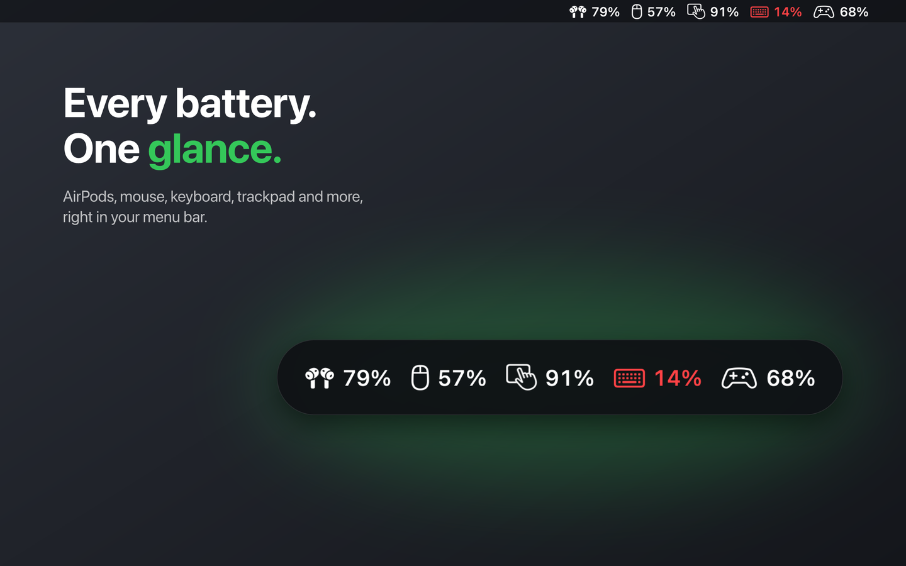

# 🔋 Battery Hub



A macOS menu bar app that shows the battery level of all your connected Bluetooth devices:

```
🎧 14%   🖱 25%   ⌨️ 10%
```

- **Expanded view** (default on every launch): an icon + percentage for each device.
- **Collapsed view**: a single battery icon showing the lowest device.
- **Red** when a device is at 20% or below.
- AirPods: the weaker earbud in the menu bar; left / right / case shown separately in the menu.
- Languages: English (base), Serbian, Bosnian, Croatian — follows the system language.

Requires macOS 13 Ventura or later. Sandboxed and ready for the Mac App Store.

## Download

Get the latest signed DMG from [Releases](https://github.com/mmuminovic/BatteryHub-for-macOS/releases/latest),
open it, and drag **Battery Hub** to **Applications**.

## Building

You need Xcode and [XcodeGen](https://github.com/yonaskolb/XcodeGen) (`brew install xcodegen`).

```bash
./build.sh            # Release build into build/DerivedData and launch it
./build.sh install    # same, but installs into /Applications (recommended)
./build.sh demo       # Debug build with fake devices (for screenshots)
```

On first launch macOS will ask for **Bluetooth permission** → click **Allow**.
(If you deny it by accident, the menu offers an item that opens System Settings → Privacy & Security → Bluetooth.)

`project.yml` is the source of truth for the Xcode project. After adding files or changing settings, run
`xcodegen generate` (manual edits made in Xcode are lost on the next generation).

## Usage

| Action | What it does |
|---|---|
| Click the icon | Menu with all devices and details |
| **⌥ Option-click** | Instantly collapse / expand the menu bar view |
| Menu → Collapse / Expand in Menu Bar | Same as ⌥-click |
| Menu → Refresh Now | Manual refresh (otherwise every 60 s + when a device connects) |
| Menu → Launch at Login | Start automatically when you log in |
| Hover over the icons | Tooltip with names and percentages |

## Where the data comes from

The app combines four sources and merges duplicates:

1. **IOKit** — Apple Magic Keyboard / Mouse / Trackpad (no permission needed)
2. **system_profiler** — AirPods, Beats, and third-party headphones whose battery macOS knows about
3. **IOBluetooth** — other connected classic Bluetooth devices (only after Bluetooth permission is granted)
4. **BLE Battery Service** — Logitech MX and other Bluetooth Low Energy devices

If a device doesn't report its battery level over Bluetooth at all (some cheaper headphones, or Logitech
devices connected via a Bolt/Unifying USB receiver instead of Bluetooth), it appears in the menu with "—" but not in the menu bar.

## Customization

- Red threshold: `BatteryDevice.lowThreshold` in `Sources/BatteryDevice.swift`
- Refresh interval: `BatteryMonitor.refreshInterval` in `Sources/BatteryMonitor.swift`
- Order and icons: `DeviceKind.sortOrder` / `symbolNames` in `Sources/BatteryDevice.swift`
- Strings: `Resources/<language>.lproj/Localizable.strings`

## Debug arguments (Debug build only)

| Argument | What it does |
|---|---|
| `-DemoDevices` | Fake devices (AirPods Pro, Magic Keyboard at 14%…) instead of real ones — no Bluetooth needed |
| `-OpenMenu` | Opens the menu 1.5 s after launch |
| `-ExportStatusItem` | Renders the menu bar view at 4x and writes the PNG as base64 to stderr (`EXPORT <name> <base64>`) |
| `-DumpSources` | Prints to stderr what each source read |

## Mac App Store

Everything for the App Store lives in `AppStore/`:

- `AppStore/metadata.md` — name, subtitle, description, keywords, privacy, review notes (EN + HR)
- `AppStore/screenshots/` — 5 screenshots at 2880 × 1800 (+ 1440 × 900)
- `AppStore/icon/` — vector icon masters (SVG + VectorCraft) and a 1024 PNG

Releasing a new version:

1. In `project.yml`, bump `CURRENT_PROJECT_VERSION` (every upload) and `MARKETING_VERSION` (every version).
2. Run `scripts/release-appstore.sh` — archives and uploads the build to App Store Connect
   (`--export-only` just builds `dist/appstore-export/Battery Hub.pkg`).

For a GitHub release, `scripts/release-dmg.sh` builds a Developer ID–signed and notarized
`dist/BatteryHub-<version>.dmg` (+ `.sha256`). Notarization needs a keychain profile created once with
`xcrun notarytool store-credentials batteryhub-notary --apple-id <id> --team-id 39KMKDXSBT`,
then run `NOTARY_PROFILE=batteryhub-notary scripts/release-dmg.sh`.

App Store signing is automatic (cloud-managed Apple Distribution, team 39KMKDXSBT); Xcode must be signed in.
Bundle ID: `com.mmuminovic.batteryhub`.
